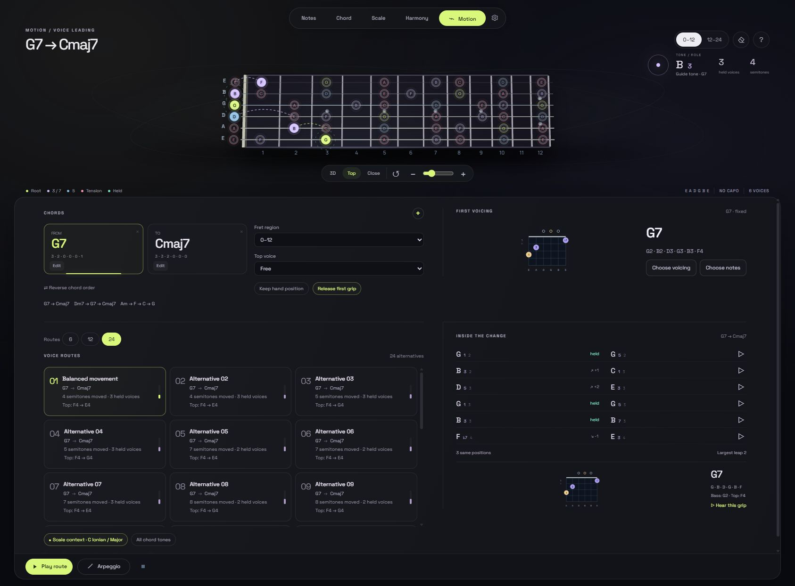
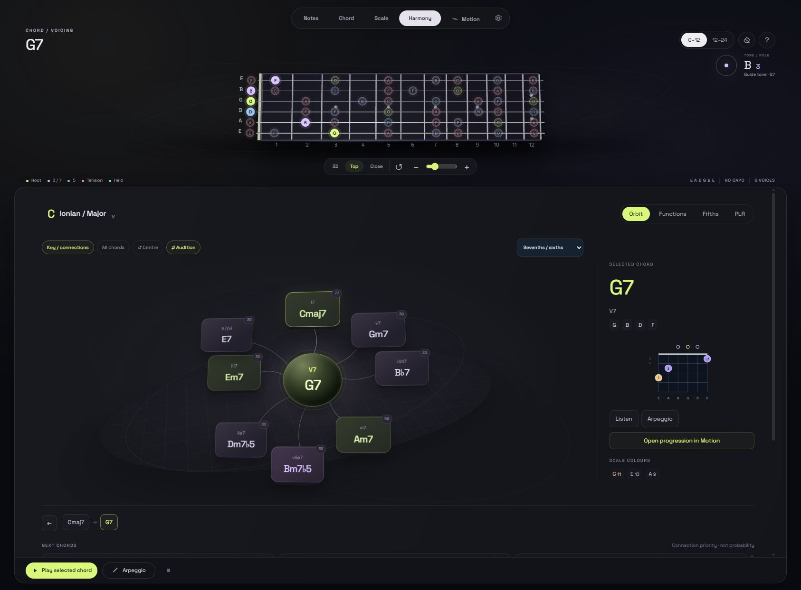

# Guitar Brain · Motion

A new guitar workspace for seeing and hearing harmony move across a playable fretboard.

[Open Motion](https://knookan.github.io/guitar-brain-motion/) · [Original studio](https://knookan.github.io/guitar-brain-koma/)



- A living fretboard shows roots, guide tones, fifths, extensions and explicit scale-context tensions.
- Build a sequence of 2–8 chords and compare 6, 12 or 24 playable guitar voice routes.
- Choose the exact first grip from the catalogue or build it string by string on the fretboard.
- Explore Orbit: select the next chord, watch it become the centre, then follow its new relationships.
- Edit the starting and target chord directly, with the full chord catalogue, add/alter/omit modifiers and slash bass; reverse the sequence with one click.
- Inspect exact held pitches, interval changes, entries/exits and physical grip movement.
- Constrain the fret region, hold/raise/lower the upper voice, or lock the first grip.
- Hear individual voice pairs, complete grips, whole routes and route arpeggios with synchronized string highlights.
- Use the inherited chord, scale, harmony, makam, tuning and export tools in the redesigned persistent workspace.
- Save progressions, start from 16 ready-made ones and share any of them as a link; fix the top note of each chord.
- Map the key as three function regions with secondary dominants, borrowed chords and cadential 6/4 (Harmony → Map).
- Practise with tempo, Loop, Metronome, Count-in, Block / Strum ↓ / Strum ↓↑ rhythms and a length of 1, 2, 4 or 8 beats per chord. Space plays or stops; ← → change chord.
- Export the whole route as timed MIDI.
- English and Turkish, mobile fixed cameras, collapsible fretboard and installable PWA.

Motion is an independent version. Its source, storage and offline cache do not replace the original studio.

## For guitarists · 1.9

**Settings → Guitar** switches to left-handed mode, mirroring the fretboard, the diagrams and the
exports. Chord diagrams show suggested fingers under the strings; they can be turned off there too.

## Readability · 1.8

No text is smaller than 10 px, all four themes pass an automated contrast sweep, and the light theme
now covers the whole page. Choose **System** under Settings → Theme to follow your operating system.

## Fast start · 1.7

The first visit now downloads about 1 MB instead of 11 MB. Guitar sounds are separate small files
fetched as they are played, and the app still works fully offline once installed. The Pages site is
staged by `node stage-pages.js site`, which copies only what the app serves.

## Library and sharing · 1.6

Open **Library** in Motion to save the current progression by name, reopen it, rename or delete it,
or start from one of 16 progressions (Pop, Jazz, Blues, Andalusian, Modal) in your key. **Copy link**
puts the progression in the address; whoever opens it sees a banner and decides whether to load it.
In a chord's editor, **Top note** fixes the melody note on top of that chord.

## Tonal harmony map · 1.5

**Harmony → Map** lays the key out as three regions: subdominant, dominant and tonic, with the
tonic at the junction. Large circles hold borrowed, Neapolitan and leading-tone chords; paired
rings show each secondary ii–V with an arrow to its target. Switch between Roman numerals and
chord names, hover a chord to see its arrows, click to select and double-click to hear it.
**Expand** gives the map the whole tools area.

## Practice · 1.4

In Motion, set **Tempo**, choose a **Rhythm**, then turn on **Loop**, **Metronome** or **Count-in**
and press Play. Give each chord 1, 2, 4 or 8 beats with the selector on its card. Space plays or
stops when no control has focus, Escape stops, and ← → move through the chords. Arpeggio ignores
the rhythm setting. The **MIDI** button in Settings' export section writes the whole route timed by those beats.

## Adjustable studio · 1.3

Use **Balanced / Guitar / Tools** to allocate space without changing your music.
Drag the separator, or focus it and use the arrow keys (Shift for larger steps).
Double-click or press Enter on the separator to restore balance. The layout
button switches between stacked and side-by-side arrangements when space allows;
the reset button restores the automatic arrangement. Proportions are remembered
separately for each arrangement. Small portrait screens stack the guitar above
the tools; short landscape screens place them beside each other. Tool layouts
follow their actual panel width. Hide the fretboard to give the tools the full
workspace, then reopen it with the visible strip. Desktop camera controls sit
in the shared toolbar, leaving the fretboard surface available for playing.
Wide Notes panels show chord and scale matches beside one another.

## Orbit update · 1.2



Harmony opens with diatonic degrees in a spatial scene. Select a degree to reveal
its next-chord alternatives; stronger recommendations appear nearer the centre.
Keep the same key/scale while exploring, go back through your history, audition
chords, or send the progression to Motion. The connection score is a transparent
heuristic, not a probability. Switch **Key / connections** to **All chords** to
explore the full chord catalogue.

In Motion, use **Choose voicing** or **Choose notes** for the first chord, then
**Apply voicing**. All route alternatives begin with those exact sounding
strings. Invalid or incomplete grips show their reason instead of silently
accepting a different chord. Wide screens use two workspace tiers; phones stack
the controls with a collapsible, fixed-camera fretboard.

See [Orbit model, sources and limits](ORBIT-MODEL.md). Version 1.1 is retained at
[motion-1.1.0](https://github.com/knookan/guitar-brain-motion/tree/motion-1.1.0).

## Harmony Atlas update · 1.1

The studio opens in **Notes**. Navigation is **Notes → Chord → Scale → Harmony → Motion**. Harmony puts the map first, with compact controls and a selected-chord inspector. Switch between functional relationships, root ordering by fifths, and PLR triad neighbourhoods. Select a map chord and use **Centre → this chord** to inspect a physical guitar route in Motion.

See [Harmony Atlas research and modeling assumptions](HARMONY-ATLAS-RESEARCH.md) for the sources and the distinction between abstract chord relationships and playable guitar movement.

## Try the first change

Open **Motion** and choose **G7 → Cmaj7**. Compare the route cards, then choose **Play route** or **Arpeggio**. Common pitches retain their register while their chord roles may change. Click any voice pair to hear that movement in isolation.

For the complete animation, choose **Settings → Animation → Full motion**. The default follows your system's reduced-motion preference. Mobile cameras remain fixed for reliable fret selection.

## Run locally

No dependency installation or build step is required:

```sh
python -m http.server 8764
```

Open `http://localhost:8764/`. To create a portable HTML copy, run `node build-standalone.js`.

## Checks

```sh
node tests/run.cjs
```

See [Motion engine and modeling limits](MOTION-ENGINE.md) for interval roles, pitch-aware pairing, bounded route search, physical fret assumptions and playback timing.

The project uses the [MIT license](LICENSE). Bundled samples/fonts retain their licenses; see [third-party notices](THIRD-PARTY-NOTICES.md). All inherited research documents remain available in this source package.
