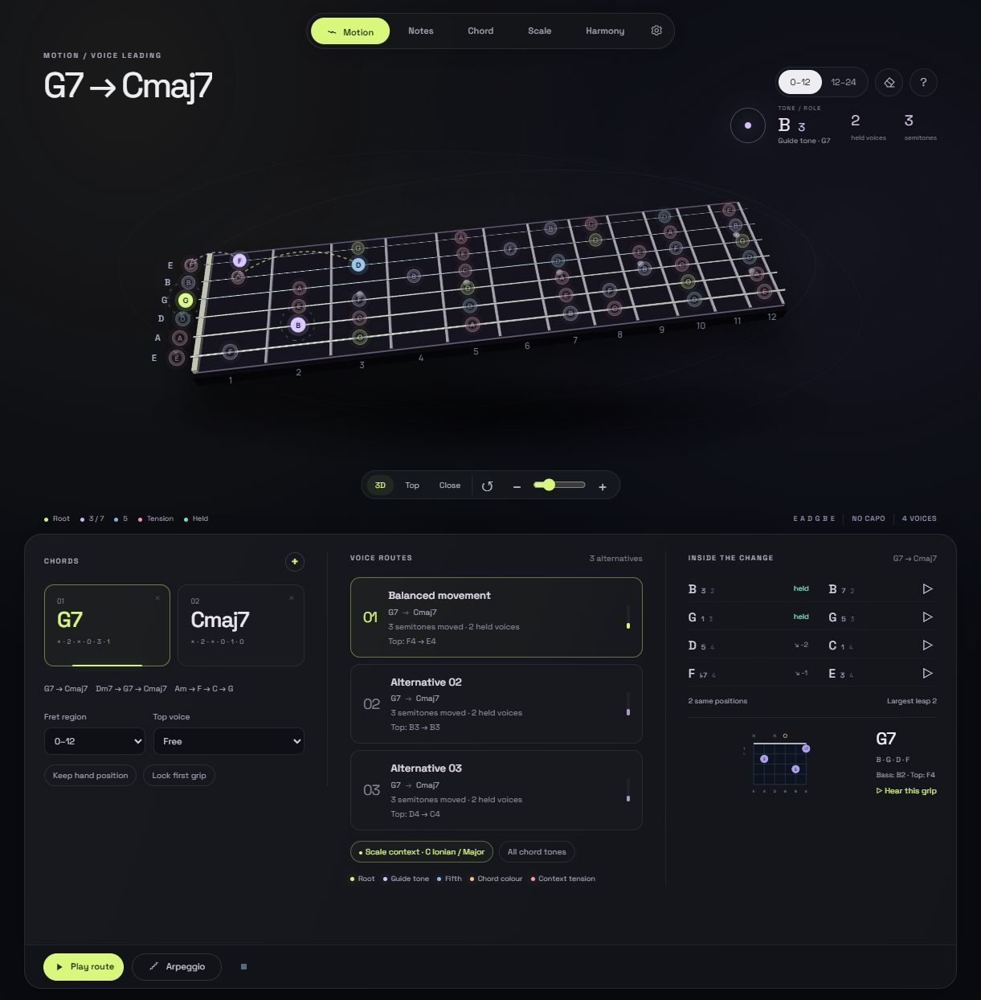

# Guitar Brain · Motion

A new guitar workspace for seeing and hearing harmony move across a playable fretboard.

[Open Motion](https://knookan.github.io/guitar-brain-motion/) · [Original studio](https://knookan.github.io/guitar-brain-koma/)



- A living fretboard shows roots, guide tones, fifths, extensions and explicit scale-context tensions.
- Build a sequence of 2–8 chords and compare three playable guitar voice routes.
- Inspect exact held pitches, interval changes, entries/exits and physical grip movement.
- Constrain the fret region, hold/raise/lower the upper voice, or lock the first grip.
- Hear individual voice pairs, complete grips, whole routes and route arpeggios with synchronized string highlights.
- Use the inherited chord, scale, harmony, makam, tuning and export tools in the redesigned persistent workspace.
- English and Turkish, mobile fixed cameras, collapsible fretboard and installable PWA.

Motion is an independent version. Its source, storage and offline cache do not replace the original studio.

## Try the first change

Start with **G7 → Cmaj7**. Compare the three route cards, then choose **Play route** or **Arpeggio**. B stays at the same pitch while its role changes from the third of G7 to the seventh of Cmaj7; D moves to C and F resolves to E. Click any voice pair to hear that movement in isolation.

For the complete animation, choose **Settings → Animation → Full motion**. The default follows your system's reduced-motion preference. Mobile cameras remain fixed for reliable fret selection.

## Run locally

No dependency installation or build step is required:

```sh
python -m http.server 8764
```

Open `http://localhost:8764/`. To create a portable HTML copy, run `node build-standalone.js`.

## Checks

```sh
node tests/run.cjs
```

See [Motion engine and modeling limits](MOTION-ENGINE.md) for interval roles, pitch-aware pairing, bounded route search, physical fret assumptions and playback timing.

The project uses the [MIT license](LICENSE). Bundled samples/fonts retain their licenses; see [third-party notices](THIRD-PARTY-NOTICES.md). All inherited research documents remain available in this source package.
